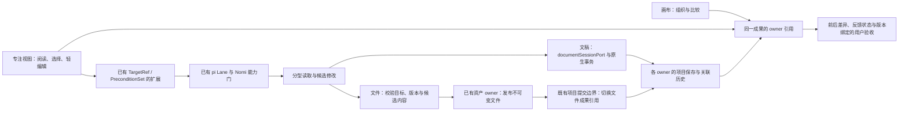

# 基于画布的 Agent 成果协作方案

📋 待评审：方案与源码调研；未实施，不代表 UI 或实现合同已获批。

版本：v0.3。调研日期：2026-10-12。补充图片/视频定点反馈、Codex 本机前端机制与 Lovart 当前 UI 观察；推荐页面式导航与同一 Agent 输入联动，先验证媒体反馈，再扩文稿/HTML 与办公成果。

本方案研究 Doop、Onlook、AFFiNE、OpenCanvas、HugAgentOS，以及用户补充的 OpenDesign，并检查 Nomi 当前代码与支撑组件。目标是确定值得做的体验、可复用的底座与最小自研范围；本轮没有修改产品代码。项目结论来自固定 commit 源码与官方资料，尚未安装运行验证。文中“已有”指源码已存在，“建议”指拟议设计，“待验证”指不能用源码检查替代的实际行为。

## 1. 建议做什么，为什么现在值得做

建议把 Nomi 的画布逐步扩展为**创作者与 Agent 共同处理成果的工作空间**：人在画布上组织、比较成果，进入成果后指明需要修改的位置；Agent 负责读懂上下文、执行修改、交付可检查的结果。

核心体验可以概括为：**指到哪里，说清问题，改动对应到哪里。**

这件事成立的依据是一个待验证的产品假设：随着 Agent 能承担更多生成和修改，人使用软件的主要摩擦会从“怎么操作编辑器”，转向“怎么准确表达不满意、怎么确认 Agent 改对了”。六个开源项目展示了这种转移的不同部分，其中 OpenDesign 已有持久元素评论、执行状态和锚点状态，是最重要的新增参考；它的可见人工审阅仍有缺口。但本次没有发现一个能够作为独立 SDK 直接接入、完整覆盖多种成果和跨版本反馈闭环的底座。我们应验证这个假设，而不能据此宣布所有编辑能力都已被替代。

轻编辑仍然必要。改一个字、换一张图、调整顺序，如果必须等待 Agent，体验可能更差。建议保留少数即时动作，把复杂排版、批量调整、跨成果整理交给 Agent。功能的取舍以完成任务的摩擦为准。

对 Nomi 的第一落点应当是**已有视频创作周围的成果协作**：先在图片和视频预览中直接提修改，再扩到方案文档、脚本说明、参考网页、分镜提案、演示稿、制作清单。先让创作者在一个项目里完成“看成果—提修改—确认结果”，再判断是否扩展为通用办公产品。网页开发 IDE、完整 Office 套件、多人白板都不是首轮目标。

真正要积累的是：创作意图、成果对象、反馈目标、执行改动与验收结果之间可靠的对应关系。外层无限画布、富文本编辑器、文件解析、公式计算、Agent 重试等都有成熟基础，应继续复用。

## 2. 用户如何完成一次任务

以“给已有视频项目准备一份合作提案”为例：

1. 用户说明目标，Agent 产出提案文档、参考网页，放在画布上。节点展示成果名称、缩略内容和当前状态。
2. 用户先并排比较，再双击打开某份成果的专注视图；画布和专注视图引用同一个成果。
3. 用户选中标题，说“太像宣传语，改成客户能看到的具体收益”；再选中一段，说“保留观点，压到一半”。系统保存位置、原文与当时版本，用户无需复述对象。
4. 用户点击“让 AI 修改”，可以提交当前一条或显式选中的几条。普通讨论评论保持为讨论，只有执行入口才发起修改。
5. Agent 读取目标与必要上下文，生成候选改动。若定位不唯一、原位置已删除或版本已变化，显示冲突，带用户回到当前内容重新定位。
6. 修改完成后，原位置显示改动标记；文字可看前后差异，视觉成果可看前后预览，并说明实际改了什么。
7. 用户确认满意、继续评论，或者撤回这次修改。执行完成、评论关闭、用户确认是不同事实。

默认采用“明确请求修改后，Agent 的校验合格结果进入当前工作版本，标为待确认”。这里的确认是用户验收，不是再次点击才保存；用户可随时撤回。涉及扩大修改范围、替换整份成果或新付费生成时，先走相应的范围选择/既有确认门。这样保留控制，同时避免每个小改动都要求两次提交。

如果 Agent 判断网页与文档需要同步修改，应列出受影响成果供用户选择；不能仅凭一条局部评论扩大到整个项目。经用户明确授权的一组修改可以批量执行，逐成果保留回执。

### 交互原则

| 场景 | 建议行为 | 借鉴来源 |
|---|---|---|
| 浏览多个成果 | 画布展示可读缩略图、关系和比较；精细操作进入专注视图 | AFFiNE 的同内容多视图；Nomi 现有画布 |
| 文本选择与画布拖动冲突 | 节点壳负责移动，内容区域负责阅读/选取；复用 React Flow 的 `nodrag`、`nopan`、`nowheel` | React Flow 官方交互约定 |
| 指出局部问题 | 选中后就地输入，自动携带对象和版本；保留原文或缩略图供用户检查 | Doop 的元素评论、Onlook 的选择上下文 |
| 多条反馈 | 可以先积累再批量提交；用户清楚看到此次包含哪些反馈 | Doop 的评论/执行区分，方案补充批量范围 |
| 简单修改 | 直接改文字、换图片、调顺序；走与 Agent 相同的提交与撤回边界 | 保留人的即时控制 |
| Agent 交付 | 展示具体改动与结果，再由用户决定满意与否 | AFFiNE 的 diff/采纳交互 |
| 评论位置变化 | 能可靠映射则跟随；不能则显示“原位置已变化”，不贴到看起来相近的对象上 | 对既有项目定位边界的补强 |

来源：[React Flow utility classes](https://reactflow.dev/learn/customization/utility-classes)。这里借用的是已有交互规则，完整布局仍需后续用生产组件出候选、经用户确认。

### 画布切换用页面，意见直接带入左侧 Agent

用户明确指出，现有左侧目录的主要作用是分开不同工作画布，希望改成 Lovart 那样的页面。当前 Lovart UI 可见顶部页面标签、底部评论/涂鸦工具、持续在场的左侧 Agent，以及评论编号和输入引用的对应；切页后草稿保留，回到原页恢复原视图。该观察来自用户已打开的项目，不推导其私有数据/执行实现，详见[Lovart 页面与 Agent 联动](../research/2026-10-12-canvas-agent-collaboration/lovart-pages-interaction.md)。

建议用顶部页面标签承接现有画布分区，不把用户导航做成文件目录。第一步复用现有 categoryId、graph 与运行期视口；内置分类仍绑定分镜等领域行为，任意混排页面需另做类型/路由解耦，不能冒充纯换组件。节点内分组和实际文件归属继续由各自 owner 管理。

点选素材时，左侧直接显示当前对象/版本/视频时刻；进入评论或标注时，同步带入同编号反馈卡片，省去再打开 Agent、找素材和重复描述位置。当前点选上下文与已写入的反馈集合分开：改选 B 不改变给 A 的意见，切页不清草稿，点击反馈可返回来源页。自动显露上下文不抢 inline 输入焦点、不自动生成，最后沿同一个 Composer 显式发送。

### 图片与视频：从预览直接进入同一个 Agent 输入框

用户补充了 Codex 图片标注/评论、擦除、去背景、改比例后进入 Agent 的体验。本机分发前端中可见：评论携带图片编号和相对坐标；标注导出覆盖层及配套文字；擦除路径可携带原图和黑白选区图；快捷动作可编译为指令并沿已有 Composer 提交。它有本地、云端、Library 等不同分支，不能当作一套处处相同的 UI。详细机制、模块哈希及未验证边界见[媒体反馈研究](../research/2026-10-12-canvas-agent-collaboration/media-feedback.md)。

建议在现有媒体预览中点选/圈选并写意见，输入框显示可点回原处的反馈卡片；发送时冻结素材结果版本、区域/时间和意见版本，再走既有 Agent、能力和生成费用门。图片支持前后版本比较；视频先支持暂停帧/明确时间段的反馈，当前视频附件没有原生 video part，使用真实截帧和时间上下文；当前按秒取帧不能宣称逐帧精确。改了 Prompt/参数只显示参数变更，真实生成完成才显示新结果，用户确认后才关闭意见。

这部分与文稿/HTML 共用反馈、执行、审阅的原则，空间与时间由媒体适配器处理。标注表达“改哪里”，Prompt/参数只是“怎么改”的一种办法；是否支持局部修补、是否保住区域外内容、视频是否连续，都需要实际模型与结果验证。

## 3. 六个开源项目：学什么，拿什么，不照搬什么

### 3.1 Doop：把反馈放在成果上

**它怎么做。** HTML Frame 在 iframe 内呈现；运行时拾取元素，返回 selector、片段和矩形。评论记录 frame、目标、正文与线程；普通评论与 `@角色` 执行分开。MCP 可以读评论、回复、处理评论，并对 HTML 做要求“旧文本恰好出现一次”的局部替换。

**最值得学。** 用户指着对象说问题，Agent 接到的是带上下文的反馈；评论、任务状态与成果处在一起。这是本方案核心交互的重要参考，OpenDesign 则进一步提供了可摘取的评论与锚点模块。

**可以如何拿。** 把选择桥的消息结构、评论转执行的入口、请求超时与 iframe 来源校验作为小模块参考。Doop 是应用代码，不能当作已封装好的评论 SDK。若移植片段，保留许可证和来源，并适配 Nomi 既有能力入口。

**需要补强。** 无 id 元素的 `nth-of-type` 定位可能因同类兄弟插入而漂移，这是依据算法的推断，尚未运行复现。唯一文本替换也不等于版本并发检查。客户端撤回栈不能证明服务端 Agent 写入都进入同一个用户撤回单元。

证据：[元素运行时](https://github.com/kgoedecke/doop/blob/1e9136dc0a837452821c837c0ea6cd7c9d140fb8/src/lib/frameRuntime.ts)、[桥接](https://github.com/kgoedecke/doop/blob/1e9136dc0a837452821c837c0ea6cd7c9d140fb8/src/lib/frameBridge.ts)、[评论与角色执行](https://github.com/kgoedecke/doop/blob/1e9136dc0a837452821c837c0ea6cd7c9d140fb8/server/actions.ts)、[修改工具](https://github.com/kgoedecke/doop/blob/1e9136dc0a837452821c837c0ea6cd7c9d140fb8/server/mcp.ts)。

### 3.2 Onlook：把视觉对象映射到可修改的源码

**它怎么做。** 给 JSX 元素注入 `data-oid`，建立 DOM 与 AST、源文件及组件实例的映射。用户选中对象后，Agent 获取源码位置、元素身份、分支等上下文。

**最值得学。** 可见对象应该有明确身份；截图可以帮助理解，却不应承担唯一定位职责。必须区分修改某个组件实例与修改全部实例的定义。

**可以如何拿。** 当前 HTML 成果先保留稳定元素 id，并在选择桥中显露它；以后如果正式支持 React 项目编辑，再评估源码映射模块的移植。其 parser 依赖 monorepo 内部模型与 Babel，不能直接当独立公共 SDK 安装。

**不照搬。** 不为一份文档/网页预览引入整套 Next.js 工程、容器与分支系统。公开仓库 README 的评论功能仍在未完成清单，本轮不能把它当成现成精准评论方案。其新 hosted 产品也不能与公开仓库能力混为一谈。

证据：[身份注入](https://github.com/onlook-dev/onlook/blob/423e2e924366419e418ee049093872d535eea41a/packages/parser/src/ids.ts)、[源码映射](https://github.com/onlook-dev/onlook/blob/423e2e924366419e418ee049093872d535eea41a/packages/parser/src/template-node/map.ts)、[Agent 选择上下文](https://github.com/onlook-dev/onlook/blob/423e2e924366419e418ee049093872d535eea41a/apps/web/client/src/components/store/editor/chat/context.ts)。

### 3.3 AFFiNE：统一成果身份，分开视图与评论适配

**它怎么做。** 文档/白板共享 block model。文本批注依附 Y.Text 标记，块和白板元素各有锚定方式，评论服务通过 provider 对接。AI 修改提供接受/拒绝交互；画布读取支持概览、区域和元素等层次。

**最值得学。** 同一个对象有多个视图；评论协议可以统一，但定位方式必须尊重内容类型。Agent 先读概览，再读相关局部，减少上下文噪声。

**可以如何拿。** 学接口划分、读取层次和 diff 交互。Nomi 已有 Tiptap/React Flow，不迁移到整套 BlockSuite/Lit/Yjs/DI；若将来多人协作成为真实需求，再独立评估 Yjs。

**需要补强。** 在一条 Markdown 替换路径中，先删块再重建并保留首块旧 id，没有看到旧文本评论标记的显式迁移。因此不能以“稳定 block id”推导所有评论连续。CRDT 也不会自动判断 Agent 的旧语义是否仍适用；服务端写入是否可由用户撤回要单独处理。

证据：[共享 Note 模型](https://github.com/toeverything/AFFiNE/blob/0b69a6da21e8fd35beb85667bb8496d9b3852238/blocksuite/affine/model/src/blocks/note/note-model.ts)、[文本评论](https://github.com/toeverything/AFFiNE/blob/0b69a6da21e8fd35beb85667bb8496d9b3852238/blocksuite/affine/inlines/comment/src/inline-comment-manager.ts)、[Agent 分层读取](https://github.com/toeverything/AFFiNE/blob/0b69a6da21e8fd35beb85667bb8496d9b3852238/packages/backend/server/src/plugins/copilot/tools/doc-canvas-read.ts)。详细修改路径见 [AFFiNE 源码笔记](../research/2026-10-12-canvas-agent-collaboration/affine.md)。

### 3.4 OpenCanvas：每种成果声明类型、数据与动作

本方案指 `ashark-ai-05/opencanvas`，不是同名其他项目。

**它怎么做。** 在 tldraw 上承载 typed widget，schema 定义数据，组件负责呈现，工具负责读取、创建与更新。插件可以用 iframe 展示。

**最值得学。** 表格、图表、页面等不必全部压成同一种 HTML。每类成果声明能看、能选、能改、能导出哪些内容，Agent 按能力调用。

**可以如何拿。** 借鉴类型注册和工具描述的组织方式，接入 Nomi 已有 capability registry。不要再建一个万能插件平台；第一版只注册我们验证过的适配器。

**不照搬。** Nomi 已用 React Flow，无需第二套 tldraw 画布。当前源码偏整 payload 更新，没有发现完整元素级评论闭环；插件进程内注册与 localStorage 粗快照也不能替代成果持久化版本。

证据：[Agent 数据协议](https://github.com/ashark-ai-05/opencanvas/blob/8e50f7fc3d0de047c531ac9be5e37255aa9615ec/src/agent/payloads.ts)、[更新工具](https://github.com/ashark-ai-05/opencanvas/blob/8e50f7fc3d0de047c531ac9be5e37255aa9615ec/src/agent/tools/update-widget.ts)、[画布读取](https://github.com/ashark-ai-05/opencanvas/blob/8e50f7fc3d0de047c531ac9be5e37255aa9615ec/src/agent/canvas-snapshot.ts)。

### 3.5 HugAgentOS：文件生成和文件展示分层

**它怎么做。** Agent 生成文件，artifact 服务交付，侧面板按格式预览：Word 用 docx-preview，PPT 转 PDF，Excel 用 Univer。这是成果面板，不是无限画布。

**最值得学。** 文件生成、文件保存、预览、导出分工，可以避免自己编写各格式编辑器。

**可以如何拿。** 优先直接使用其采用的上游组件，研究文件交付接口；不直接引入整个应用。Office 中的对象定位仍需由我们的格式适配器负责。

**需要避开。** 它的表格导出路径用 `getValues()` 和 SheetJS 重新生成工作簿，不能当成通用 Excel 保真回存。预览可见也不代表可以把点选对象映射回 Office 内部对象。当前仓库 LICENSE 还包含竞争性 SaaS 和品牌要求，不能按纯 Apache-2.0 无附加条件理解。

证据：[成果模块说明](https://github.com/ZJU-REAL/HugAgentOS/blob/a07b9f74919f518ea907112bb78c50dc37e99349/document/en/modules/canvas-artifacts.md)、[文件转换](https://github.com/ZJU-REAL/HugAgentOS/blob/a07b9f74919f518ea907112bb78c50dc37e99349/src/backend/api/routes/files.py)、[许可证](https://github.com/ZJU-REAL/HugAgentOS/blob/a07b9f74919f518ea907112bb78c50dc37e99349/LICENSE)。详细路径见 [源码笔记](../research/2026-10-12-canvas-agent-collaboration/opencanvas-hugagentos.md)。

### 3.6 OpenDesign：优先学它的评论闭环，摘取小模块

本方案主对象是 [nexu-io/open-design](https://github.com/nexu-io/open-design)，官网的 [source page](https://open-design.ai/official/) 明确指向该仓库。核验 SHA：`17e255959703a3fad7c8eb7f7b70dcafccc5629a`。它主要是聊天、文件工作区和 iframe 预览，不能因为界面叫 canvas 就认定为无限多成果画布。

**它怎么做。** 当前源码有持久 `PreviewComment`，目标包含文件、selector、elementId、HTML 提示、位置、slide 与版本。处理状态包含 `open / attached / applying / needs_review / resolved / failed`；锚点状态另外记录 `anchored / reanchored / stale / lost`。可单点或选一组对象提出反馈。AI 执行结束后可标记为 `needs_review`，不直接等同用户已满意。

**最值得学。** “工作执行到哪了”和“评论还指得准不准”必须分开。目标丢失不应显示成 Agent 工作失败；Agent 修改成功也不应使定位漂移问题消失。评论是可回看、有上下文的记录，而不仅是一次 prompt。

**审阅交互有重要缺口。** 所查 FileViewer 的侧栏与 pin 只筛 `status === open`，其他状态虽存数据库但不画 marker；本轮没有找到完整用户认可并 resolved 的触发链。因此 `needs_review` 存在不等于已有可见逐条验收闭环。Nomi 的待验收项必须持续可见，带前后结果与版本绑定，不能发送后就让反馈标记消失。证据：[FileViewer 状态筛选](https://github.com/nexu-io/open-design/blob/17e255959703a3fad7c8eb7f7b70dcafccc5629a/apps/web/src/components/FileViewer.tsx#L15730)。

**具体怎么拿。** 第一阶段优先评估下面这些代码，而不是自己写另一套通用锚点恢复和 HTML 编辑桥：

| 模块 | 取用建议 | 接入边界 |
|---|---|---|
| `packages/contracts/src/api/comments.ts` | 学/适配评论目标与双状态字段 | 纯类型，运行依赖小；字段并入 Nomi 现有 TargetRef 与项目记录，不平行维护第二套权限目标 |
| `apps/web/src/comments.ts` 的 `resolveCommentAnchor`、`planLostAnchorWriteBacks` 等纯函数 | 优先摘取相关函数、测试与 Apache 声明 | 无运行时 import 的小闭包；按 Nomi selector/version 类型适配；模糊结果先用于展示/重定位建议，不自动取得写权限 |
| `apps/web/src/edit-mode/source-patches.ts` 与 `types.ts` | 优先复用受控 HTML 局部修改机制与测试 | 基于浏览器 DOMParser/来源标记；不是任意 React 工程的 AST 编辑器 |
| `apps/web/src/edit-mode/bridge.ts` | 评估元素选择、直接编辑与宿主交接协议 | 浏览器桥仍需收紧为 Nomi 允许的消息和真实 preview 生命周期 |
| `srcdoc.ts` 内 `injectSelectionBridge` | 只提取必要函数闭包，借单点/成组选择 | 原文件约 193KB、有多个内部依赖；不整份复制进节点组件，补 Nomi 的来源校验 |

这些是应用内部源码，**不是直接 npm 安装的公共 SDK**。摘取前固定来源、核验最小依赖、保留声明并移植有效测试；以后记录来源版本，避免无来源的复制粘贴。原有 React Flow/Tiptap/pi 继续保留。

**不能顺手承诺。** 当生成 HTML 缺少 id 时，它的一条路径会按 sourcePath 注入 `path-*` 标识；结构路径不等于跨版本稳定身份。精确 id 命中在版本变化时可标 `reanchored`，也不证明对象语义未变。当前手动文件修改看到的是 GET 全文比对再 PUT 全文+parentVersionId 的客户端检查；parentVersionId 在所查路径用于来源继承，不能当作拒绝过期写入的服务端原子 CAS。我们必须在现有 owner 提交口验证并发，不能用一次预检查代替。选择桥部分未核验 ev.origin 的消息接收也不能照搬，移植时按 Nomi 的发送方/请求/成果版本边界收紧。

执行回执关联还在其较大的应用状态逻辑里，不能整体搬进 Nomi。上游解决了很多交互细节，但我们的项目 owner、修改边界、撤回与真实生产事实仍需衔接。

**它还改变了演示稿选型。** OpenDesign 以 HTML slides 为真源，页面用 `section.slide` 和 `data-slide-id`，预览与 Agent 编辑围绕同一 HTML。界面默认 editable 导出走 `dom-to-pptx`；截图模式走 PptxGenJS。服务端 API 不传 editable 标记时默认是截图，因此不能仅凭“支持 PPTX”判断其编辑性。后续演示稿优先试这条 HTML-first 路线，免去首轮自研一套 SlideModel 和布局引擎。

dom-to-pptx 可将文字、形状、图片转换为 PPT 对象，但复杂背景等可能栅格化。SVG 矢量嵌入还可能需要 PowerPoint 的 Convert to Shape，不等于原生数据图表/表格。OpenDesign 固定使用 2.0.1；上游本轮源码已到 2.1.2，升级与保真需单独验证。出处：[dom-to-pptx 官方使用说明](https://github.com/atharva9167j/dom-to-pptx/blob/master/USAGE.md)。

优先用其 browser bundle，在现有 Electron Chromium 内导出，避免 npm 的 Node/CLI 路径额外拉入 Puppeteer/第二份浏览器。复杂背景与中文字体修正仅在成熟库实测不足时摘取 OpenDesign 的必要适配，不整份复制约 153KB 的 deck-capture。证据：[OpenDesign vendor 说明](https://github.com/nexu-io/open-design/blob/17e255959703a3fad7c8eb7f7b70dcafccc5629a/apps/desktop/vendor/dom-to-pptx/README.md)。

可迁移的验证用例包括 `apps/web/tests/comments.test.ts`、`comment-anchor-writeback.test.ts`、`edit-mode/source-patches.test.ts`，以及 desktop 的 `pptx-editable-fidelity.test.ts`/`pptx-layered-background.test.ts`。它们作为上游案例，不代表 Nomi 已通过对应测试。

源码：[评论合同](https://github.com/nexu-io/open-design/blob/17e255959703a3fad7c8eb7f7b70dcafccc5629a/packages/contracts/src/api/comments.ts)、[锚点纯函数](https://github.com/nexu-io/open-design/blob/17e255959703a3fad7c8eb7f7b70dcafccc5629a/apps/web/src/comments.ts)、[局部补丁](https://github.com/nexu-io/open-design/blob/17e255959703a3fad7c8eb7f7b70dcafccc5629a/apps/web/src/edit-mode/source-patches.ts)、[编辑桥](https://github.com/nexu-io/open-design/blob/17e255959703a3fad7c8eb7f7b70dcafccc5629a/apps/web/src/edit-mode/bridge.ts)。

**同名项目不能混用。** `pages.undefined83.org/open-design` 的文档描述“点元素评论、双击文字提出 old→new 编辑、交给 MCP Agent”，但 `od_get_comments` 读取即清空队列；它是交接机制，不是持久讨论。其 GitLab 源码本轮匿名不可读，无法固定版本与许可，因此仅作为文档交互参考。另一个旧名 `dporkka/opendesign` 指向 Open CoDesign 系列，是不同代码线。主项目的持久评论与这些读取清空的机制不能合并成一套已核验能力。出处：[undefined83 评论文档](https://pages.undefined83.org/open-design/using/review-and-comment/)。

### 复用结论

| 项目 | 默认选择 | 许可证与工程边界 |
|---|---|---|
| Doop | 学反馈流程；选择桥可评估小段移植 | AGPL-3.0；逐文件保留声明，不能视为独立 SDK |
| Onlook | 学稳定对象/源码映射；开发型网页场景再评估 parser | Apache-2.0；内部依赖需拆解 |
| AFFiNE | 学多视图、分型锚点、diff 与读取层次 | 前端/BlockSuite 主要 MIT；backend/common/native 有不同许可范围，不能称整个仓库 MIT |
| OpenCanvas | 学 typed artifact 与受约束动作协议 | 项目 MIT；tldraw 版本与生产许可另查，不随项目 MIT 自动获得 |
| HugAgentOS | 复用它使用的上游文件组件，借鉴交付分层 | 应用许可有附加商业限制，默认不移植应用代码 |
| OpenDesign（nexu-io） | 评论闭环作为主要参考；优先摘取锚点纯函数、HTML 局部补丁与小型桥接模块 | 根 Apache-2.0；具体技能/模板有独立来源与许可，逐项核验 |

主要复用方式因此是“成熟 npm 组件 + 已有 Nomi 能力 + OpenDesign 的小型源码模块”。开源应用还提供可验证的交互参考。没有必要整体 fork 其中一个，再重新接回 Nomi。

## 4. 支撑组件：明确选型，而不是工具清单

### 4.1 第一阶段选定的底座

| 职责 | 选择 | 已提供什么 | 我们只补什么 |
|---|---|---|---|
| 外层画布 | 继续 `@xyflow/react` 12.11.5 | 节点、连线、视口、选择、交互约定 | 成果节点的展示和专注入口 |
| 文字轻编辑与批注显示 | 已有 Tiptap 3 / `@tiptap/pm` | 富文本、事务、位置 Mapping、DecorationSet | 评论线程与目标关联、删除/过期策略、Agent 修改边界 |
| 文档对象 id | 评估开源 `@tiptap/extension-unique-id` 3.23.5 | 为配置的节点类型维护 id | 与现有 schema、导入/复制/Agent 替换的兼容验证；与 core/pm 同版本 |
| Agent 执行 | 现有 pi 0.85.1 与 Nomi lane host | 会话、顺序、持久化、重试、压缩、steering | 面向成果的读/改/验收工具，沿用现有权限与预算门 |
| 目标与写入条件 | 扩展现有 `TargetRef` / `PreconditionSet` | 文档选区冻结、版本/hash 检查，画布/素材/制品目标 | 通用成果内元素目标，以及对应版本条件 |
| 项目文件与预览 | 现有资产存储、预览 HTTP 服务、Electron | 文件/hash/项目边界，受控本地预览与截图原语 | 成果逻辑身份、版本引用，以及受限选择桥 |
| 类型与参数校验 | 已有 Zod | 输入结构校验 | 每类适配器允许的动作与效果合同 |
| HTML 评论与局部编辑适配 | 优先移植 OpenDesign 上述纯函数/小模块 | 锚点恢复、丢失状态、来源标记 HTML 补丁 | 转接现有目标、项目 owner、版本门与撤回；不整体迁移应用 |

Tiptap 核心/开源 Unique ID 为 MIT。其完整 Comments 产品位于私有 `@tiptap-pro/extension-comments`，涉及订阅与 Document server/TiptapCollabProvider，**不作为本方案的免费开源评论服务选型**。评论位置转换直接使用 ProseMirror；线程持久化与工作流是薄业务层，不自写文本位置变换算法。出处：[Tiptap Unique ID](https://tiptap.dev/docs/editor/extensions/functionality/uniqueid)、[Tiptap Comments](https://tiptap.dev/docs/comments/getting-started/overview)、[ProseMirror reference](https://prosemirror.net/docs/ref/)。

### 4.2 按需求增加的组件

| 能力 | 推荐组件 | 使用时机 | 不能据此承诺的事 |
|---|---|---|---|
| 图片区域批注 | Annotorious / `@annotorious/react`，BSD-3-Clause | 第一阶段若要圈参考图区域 | 图片被替换/裁切后自动理解新语义位置 |
| HTML DOM 更新连续性 | morphdom，MIT | 只有需要保留滚动/焦点等运行态时增加 | 它不是源文件 patch、身份生成或评论语义迁移器 |
| 结构数据补丁 | fast-json-patch，MIT | slide/table 的受约束结构修改 | 单独提供版本并发、语义对象身份或跨文件事务 |
| HTML 演示稿导出 | dom-to-pptx，MIT；先验证 OpenDesign 所用 2.0.1 | 第二阶段 HTML slides → PPTX 的优先路线 | 所有 CSS/图表/表格都变成原生可编辑对象、导入已有 PPT |
| 明确结构的 PPTX 生成/截图输出 | PptxGenJS，MIT | 后续确需原生数据对象或显式选择截图模式时 | 导入任意已有 PPT、模板编辑、往返保真；不另建竞争的编辑真源 |
| 原生文档导出 | docx，MIT | 文档结构 → DOCX；明确范围的模板替换 | 任意 Word 文件保真重排与编辑 |
| 表格轻编辑/公式 | Univer OSS，Apache-2.0 | 真实需求需要格子选区、表格计算时 | Pro 的 XLSX 导入导出服务自动包含在 OSS 中 |
| 表格文件读写 | SheetJS CE，Apache-2.0 | 明确范围的数据交换与导出 | 公式计算与所有高级对象往返保真 |
| 外来 DOCX/PDF 预览 | docx-preview（Apache-2.0）/ PDF.js（Apache-2.0） | 第三阶段的外来文件查看 | 预览坐标天然等于 Office 源对象坐标 |
| 外来 Office 文件结构修改 | iOfficeAI/OfficeCLI，Apache-2.0 | 第三阶段优先做真实文件能力试验 | 任意文件保真、组内任意对象可选、外部重写后身份不变 |

来源：[Annotorious](https://github.com/annotorious/annotorious)、[morphdom](https://github.com/patrick-steele-idem/morphdom)、[fast-json-patch](https://github.com/Starcounter-Jack/JSON-Patch)、[PptxGenJS](https://gitbrent.github.io/PptxGenJS/)、[docx](https://docx.js.org/)、[Univer](https://docs.univer.ai/)、[SheetJS CE](https://docs.sheetjs.com/)、[docx-preview](https://github.com/VolodymyrBaydalka/docxjs)、[PDF.js](https://github.com/mozilla/pdf.js)、[iOfficeAI/OfficeCLI](https://github.com/iOfficeAI/OfficeCLI)。具体许可和能力核验记录见文末附录。

这里的“成熟”指已有可核验功能、源码和文档，不代表已在 Nomi 验证。新增依赖在接入时锁定实际版本，并通过真实内容验证。无需为了这份方案预先安装全部组件。

### 4.3 本轮暂不采用的基础

- **整套 tldraw / BlockSuite**：与已有画布、文本编辑底座重叠。tldraw 当前生产许可也需单独核验。
- **Hypothesis 整套客户端**：适合网页阅读批注，功能范围较大。其当前锚定代码是客户端内部模块，不是即插即用的独立 npm 库；老 `dom-anchor-text-*` 包不能因功能吻合就视作维护活跃底座。
- **OfficeCLI 作为第一版基础**：保留第三阶段专项验证。`iOfficeAI/OfficeCLI`（npm `@officecli/officecli`）与 `officecli/officecli` 是不同项目，不能以同名混用。前者已提供部分预览→对象路径映射，值得直接利用，见下节。
- **新 Agent 框架、自己写的重试/会话/队列体系**：Nomi 已有 pi 与明确框架边界。Agent 承载更多能力，意味着工具和上下文更好，不意味着再造执行框架。

### 4.4 一个可直接降低自研量的发现：OfficeCLI 的 PPT 选择桥

当前 iOfficeAI/OfficeCLI 源码在 PPT HTML 预览中为顶层对象输出 `data-path`，优先使用 shape id。预览点击得到的路径可以交给同一 CLI 读取/修改，我们只需要包装文件版本、请求范围与提交回执，有机会省去自己编写 Office DOM 和预览对象映射。

限制也明确：组内子元素当前没有独立路径，选择会落到整组；页面位置和外部重写仍需要版本约束。它依赖原生程序运行时，自包含分发并不等于 Electron 打包/签名/各平台已验证。建议用真实 PPT 做顶层文字/图片选择、修改、另存、重开与撤回探针，再决定是否接入。不能把它与 PDF 区域反推源对象的路线混在一起。

证据：[路径生成](https://github.com/iOfficeAI/OfficeCLI/blob/699cafbc8f0b8a7841c6cca53dafd0c24e982f56/src/officecli/Handlers/Pptx/PowerPointHandler.HtmlPreview.cs#L664)、[HTML 的 data-path](https://github.com/iOfficeAI/OfficeCLI/blob/699cafbc8f0b8a7841c6cca53dafd0c24e982f56/src/officecli/Handlers/Pptx/PowerPointHandler.HtmlPreview.Shapes.cs#L41)、[组内对象限制](https://github.com/iOfficeAI/OfficeCLI/blob/699cafbc8f0b8a7841c6cca53dafd0c24e982f56/src/officecli/Handlers/Pptx/PowerPointHandler.HtmlPreview.Shapes.cs#L2293)。

## 5. Nomi 已有哪些能力，实际缺口在哪里

核验工作树 SHA：`6d28f3863244edbdf6e013bea33d26baff0f9615`。研究阶段未刷新远端；本次 PR 发布时已刷新远端并通过 delivery:preflight，分支基线与该 SHA 相同。

| 当前源码事实 | 本方案的处理 |
|---|---|
| `agent-artifact` 已支持 svg/html/markdown/table/text/glb，meta 主要是 fileType/url/agentRunId | 扩展现有成果入口；静态 table 仍是 HTML，不能标成 Excel 编辑器 |
| `make_artifact` 是整文件创建；`write_node_text` 面向文字节点 | 在现有能力注册处增加受约束的成果局部修改，不建另一套工具系统 |
| `DocumentAnchorRef` 有 range/cursor/end，`TargetRef` 有文档、画布、素材、Run artifact | 扩展同一套类型；不再造 `UniversalTarget` 并行定义 |
| `documentWriteTarget` 已冻结选区、捕获 revision/hash、拒绝过期写入 | 复用这条用户意图边界，推广到成果对象 |
| 文稿已经存为 `workbenchDocuments.contentJson`，`documentSessionPort` 是随项目存在的读写入口 | 文稿仍由原 owner 持有；成果视图引用 documentId，不把正文复制进新的文件账本 |
| 资产 store 已有项目文件、sha256 与发布检查；asset id 与路径有关 | 文件存储继续归资产 owner；跨版本逻辑身份需要最小元数据扩展 |
| `ProductionArtifact` 已有版本、hash、来源，但属于影视 ProductionRun | 保留其领域归属；普通成果不需要启动影视 Run |
| 画布有 `canvasDocumentCommit` 与撤回 journal，且保护生成事实 | 成果指针切换接入共享提交/撤回边界，不能只在面板做独立 history |
| 已有本地 artifact/asset 共用预览服务、WebContentsView 与 capturePage 原语 | 复用服务和生命周期原语；不每个节点新起服务器或长期挂一个浏览器 |
| HTML srcdoc 当前受宿主 CSP 约束，内联脚本受限 | 选择桥先做运行边界探针，不放宽全局 CSP 来绕过 |

本地证据：[目标与条件](https://github.com/aqm857886159/Nomi/blob/6d28f3863244edbdf6e013bea33d26baff0f9615/electron/shared/capabilityTargeting.ts)、[冻结选区](https://github.com/aqm857886159/Nomi/blob/6d28f3863244edbdf6e013bea33d26baff0f9615/src/workbench/creation/documentWriteTarget.ts)、[成果类型](https://github.com/aqm857886159/Nomi/blob/6d28f3863244edbdf6e013bea33d26baff0f9615/src/workbench/generationCanvas/model/artifactMeta.ts)、[能力入口](https://github.com/aqm857886159/Nomi/blob/6d28f3863244edbdf6e013bea33d26baff0f9615/electron/shared/agentCapabilities/verbs/writeVerbs.ts)、[画布提交](https://github.com/aqm857886159/Nomi/blob/6d28f3863244edbdf6e013bea33d26baff0f9615/src/workbench/generationCanvas/store/canvasDocumentCommit.ts)、[资产存储](https://github.com/aqm857886159/Nomi/blob/6d28f3863244edbdf6e013bea33d26baff0f9615/electron/assets/uploadContentStore.ts)、[共用预览服务](https://github.com/aqm857886159/Nomi/blob/6d28f3863244edbdf6e013bea33d26baff0f9615/electron/productionRun/artifactPreviewHttpServer.ts)、[Agent host](https://github.com/aqm857886159/Nomi/blob/6d28f3863244edbdf6e013bea33d26baff0f9615/electron/agentLane/laneHost.mts)。

文稿补充证据：[documentSessionPort](https://github.com/aqm857886159/Nomi/blob/6d28f3863244edbdf6e013bea33d26baff0f9615/src/workbench/project/documentSessionPort.ts)。其当前 revision 使用 updatedAt，hash 来自派生纯文本；这不是覆盖全部格式/结构变化的通用文件版本合同。P0 应核验结构变更和连续提交的版本唯一性，不能把现有纯文本校验原样推广为所有成果的完整一致性保证。

## 6. 建议的系统结构

### 6.1 成果的唯一所有权

建议采用**按类型引用现有 owner**的成果身份：已有文稿直接引用 documentId 和当前原生 JSON owner，不复制正文；文件型成果在现有项目持久化/资产 owner 下增加最小逻辑记录：`artifactId、kind、currentRevision、文件引用、contentHash、来源`。字节继续使用现有资产存储；版本是不可变内容引用。节点只保存成果引用和自己的显示布局。统一的是引用合同，不是把各类型现有真源搬进一套新数据库；缓存和视图不能另当账本。

它不同于当前路径相关的 asset id：标题改名或新版本文件换路径，不应改变用户讨论的逻辑成果身份。评论正文、锚点、用户确认等业务记录也归项目 owner；执行状态从对应 pi/工具回执投影，不在评论记录里另跑一套任务引擎。它不取代 ProductionRun 的阶段与制品记录；来自 Run 的成果保留 run/stage/artifact 来源引用，并沿用该 Run 的权限与花钱语义。一般文档可以没有 Run。

来源引用绑定产生该成果时的 Run artifact/version/hash，不随当前工作版本更新而重写过去的生产事实。普通评论修改生成一个有来源的新修订；若请求重新进入某个生产阶段，走原 Run 的领域入口与授权，不通过通用成果 patch 偷改阶段状态或生成记录。

实施前需用 door-map 核清项目保存与资产引用入口，确定现有 owner 内的准确落点。这个步骤是为了复用现有持久化边界；本方案不提前另建“成果数据库”。

### 6.2 一个反馈目标包含什么

在现有 `TargetRef` 上扩展成果局部目标，而非设计第二套协议。建议语义包括：

| 字段 | 用途 |
|---|---|
| project/artifact identity | 明确目标属于哪个项目、哪份成果 |
| revision + contentHash | 明确用户看到和 Agent 读取的是哪个版本 |
| commentRevision / 意见内容指纹 | 用户执行期间改了意见，旧尝试不能据此标记新意见已完成 |
| typed anchor | 文档块/选区，HTML 元素，slide/shape，sheet/cell 或图片区域 |
| quote / excerpt / thumbnail | 给人核对，辅助确认目标；不单独承担自动写入授权 |
| intent + requested scope | 普通讨论还是要求修改，以及允许影响的对象范围 |

定位和并发是两道独立条件：对象 id 能回答“是哪一个”；版本检查能回答“还是不是用户当时指的那个状态”。只满足其中一项不足以写入。

另外要冻结用户意见版本：发起尝试时记录反馈内容，提交前检查意见是否仍对应本次请求；完成回写也只能处理这一版意见。Open CoDesign 的评论内容指纹与完成前比较测试可作小模块参考，但它仅保护评论状态，不替代成果文件版本门。不同代码线与依赖差异见同名补充报告。

selector 的交换语义参考 W3C Web Annotation 的 TextQuote/TextPosition/Fragment/SVG 等标准；宿主仍使用现有 TargetRef 承载项目权限与版本，不引完整 JSON-LD 运行时，也不把标准误当作跨版本自动定位服务。出处：[Web Annotation Data Model](https://www.w3.org/TR/annotation-model/)。

同版本多个修改可构成一个候选事务；批次中若有目标冲突，默认先列冲突、只执行用户明确选中的有效项。不同成果不宣称跨文件全局原子提交，应逐项回执、明确部分成功。

**锚点跟随只更新评论的展示位置，不延长旧写入授权。** 映射后的旧评论仍携带原 revision；若当前版本已变，旧候选必须拒绝，重新读取和核验后才能准备新尝试。跨重启只有保存了有效位置及对应版本、或可验证的映射结果才能恢复；缺少映射依据就标为需重新定位，不凭相似文字直接写入。

### 6.3 不同类型如何保持对应

| 成果类型 | 原生结构与锚点 | 修改与展示边界 |
|---|---|---|
| 文档 | 当前 Tiptap/ProseMirror 文档；稳定 block id + selection | 用事务 Mapping 映射已提交的选区；被删的对象标为失效；Markdown 是交换格式 |
| HTML 网页 | HTML 源内容 + 稳定元素 id；DOM 是预览 | 用解析器/DOM API 操作受限目标；源码更新后重新渲染与校验；不依赖 nth-of-type 永久定位 |
| 图片 | 原图 identity/revision + 归一化区域 | Annotorious 提供圈选；换图后需重新验证区域，不承诺语义自动迁移 |
| HTML 演示稿 | HTML slideId + 稳定元素 id，复用同一网页局部修改机制 | 缩略/专注共享 HTML；dom-to-pptx 导出；PPT 编辑性与外部回存另验 |
| 原生表格 | Univer 原生数据；sheetId + 明确版本的格子选区 | 插行列走引擎事件/映射；无法保证映射就让旧反馈过期，不能只保留 A1 坐标 |
| 外来 DOCX/PPTX/PDF | 原始文件与预览版本；页/区域/文本摘录 | 初期只读批注；可“生成修改版”，但只有验证格式级映射/回存后才称局部编辑 |

OfficeCLI 试验通过的 PPT 顶层对象可在最后一行之外升级为可执行目标，复用其 `data-path`。HTML 演示稿导出与已有 Office 文件修改是两条不同输入路线，每份成果只选一个修改真源，不能让 PPTX 文件、HTML 正文与预览 DOM 同时互相覆盖。

不要定义一个重做所有编辑器的万能 JSON。统一的是身份、目标、读改能力、回执与版本边界；内容继续使用成熟引擎的原生结构。对于 HTML，浏览器 DOMParser/标准 DOM API 足够的路径优先复用；需要服务端保真解析再选择成熟解析器，不手写 HTML parser。

### 6.4 局部修改如何落地

建议工具逻辑为“读取目标 → 提交候选改动 → 校验并保存版本”，并注册进已有 Agent capability 系统。概览读节点与标题；局部读目标、上下文和必要结构；写入时必须带期望版本和受影响范围。

文档优先提交 ProseMirror transaction。HTML 的第一版限定文字、属性、图片引用与受控子树替换；更广的重排作为显式范围更大的修改。结构数据若用 RFC 6902，使用已有 JSON Patch 库，在副本上校验与应用，成功后才发布；数组下标不是永久对象身份，库的默认原地修改也不是事务。

候选结果至少要通过：参数/schema、目标唯一性、版本/hash、允许范围、格式解析与必要渲染检查。结构可自动核实的范围必须由工具拦住；Agent 只写一句“我只改了标题”不能成为证据。复杂视觉重排无法全自动证明时，明确展示实际范围和前后结果。

### 6.5 保存、撤回、恢复

文稿修改通过原 documentSessionPort/原生事务和项目保存链生效，评论与历史引用同一次提交关联；不能另外覆盖一份 Markdown 文件再反向同步正文。文件型成果的新内容先落到临时位置，校验后发布不可变文件，再由唯一 owner 在期望版本匹配时切换当前引用。所有版本和评论引用要通过现有项目保存链持久化。引用切换失败，原版本保持有效，新候选可清理；不能先覆盖原文件再期待 Agent 修回来。

文件发布与项目文档保存之间的崩溃恢复需要专项验证。不要把“一次 rename”说成跨多个文件/账本的事务；沿用现有可靠写入原语，设计可识别的未提交候选与恢复路径，不另写通用事件溯源引擎。

撤回以一次用户修改批次为单位，恢复此前成果引用，并按原位映射恢复反馈展示。它不能删除已发生的供应商调用、花费记录或生产事实；撤回结果版本与真实调用事实分开保留。

单成果一次已提交批次是最小撤回单元；跨成果批次逐成果撤回并显示结果。若修改后又发生人工编辑，不能直接把整份成果指针退回而丢掉新内容：支持且验证过的原生逆事务可尝试冲突检查，否则提示存在后续修改，打开版本对比供用户明确选择恢复范围。文件成果默认只在当前 revision 等于该批次结果时一键退回；不自写通用三方合并器。

状态词约定：**候选未提交**只在准备/校验阶段；**已应用，待验收**表示已进入当前工作版本；**已验收**绑定具体 revision。用户不能对已经过期的结果点确认；新版本需要检查对应改动。线程有未处理反馈时也不能因一次工具成功整体关闭。

### 6.6 HTML 预览的运行边界

推荐探针路线：缩略节点继续轻量渲染；专注预览评估复用现有 WebContentsView 生命周期、独立 session 与截图原语，用受限桥传回对象 id/选区/矩形。共用现有本地预览服务。不能直接把互联网浏览器整套权限搬进成果预览。

预览不接触 Node/文件系统，不暴露任意主进程调用；桥仅允许选择、读受限结构和截图等已定义消息。校验发送方、成果身份、当前 revision 与请求 id。远程导航、网络资源与用户脚本分别声明能力；第一阶段优先可控静态成果。使用 WebContentsView 不是免校验许可证或安全边界，需在真实 Electron 中验证焦点、叠层、销毁和最小窗口。

出处：[Electron web embeds](https://www.electronjs.org/docs/latest/tutorial/web-embeds)。当前 srcdoc 的 CSP 问题应在此边界内解决，不能为选择功能整体放宽宿主 CSP。

## 7. 真正需要自己写的部分

| 范围 | 为什么仍需要 Nomi 写 | 复用到哪里为止 |
|---|---|---|
| 成果与创作上下文关联 | 文档/网页/提案与分镜、素材、制作阶段的关系是 Nomi 领域 | 项目资产、Run 来源和现有图关系 |
| 反馈进入 Agent 的意图边界 | 哪些反馈要求执行、允许改哪些成果、何时待确认，是产品合同 | 已有 TargetRef、能力门、pi steering 与 transcript |
| 各类型到统一反馈目标的薄适配 | 同一个“指出问题”交互需映射到成熟引擎各自的对象 | 文本位置映射、区域圈选、格式解析与计算交给库 |
| 修改与已有撤回/生成事实衔接 | 结果可撤回，真实生成事实不能被 UI undo 擦掉 | canvasDocumentCommit、现有 journal 与生产账本 |
| 创作者能看懂的差异与验收 | 用户需要知道满意部分是否稳定、还有什么未完成 | 复用文本 diff/预览/截图原语，补领域化呈现 |

其中评论锚定、预览桥、事务模式本身是通用问题，**不能因为需要少量适配就称作独有算法**。自研应限定为现有通用能力之间的接线和 Nomi 的业务决策；接入时登记在既有框架边界/自写清单中，逐项说明为什么已有公共 API 不够。

明确不自己写：富文本引擎、无限画布引擎、公式引擎、Office 文件解析/渲染器、DOM diff、文本位置变换、通用 Agent 会话/重试/压缩/存储框架。

## 8. 分阶段落地与停止条件

### P0：先验证媒体反馈，再验证文稿/HTML

**P0-A，优先媒体。** 先用一张已有真实图片完成 2–3 条定点评论 → 同一 Composer → 已有参考图执行路线 → 新结果/原意见对账；再用真实视频验证暂停截帧、时间段反馈、同一输入草稿和对应镜头参数调整。视频局部修复、对象跟踪和原生 MP4 模型输入不作为这一步的承诺。草稿恢复、目标/意见版本、能力范围与性能证据见[媒体验收矩阵](../research/2026-10-12-canvas-agent-collaboration/media-feedback.md#7-建议的最小验证顺序与指标)。这些是推荐的探针顺序，未实施或获准为 UI 合同。

**P0-B，再验证通用成果。** 范围只含一份**已有原生文稿**（Markdown 可导入/导出）和一份受控静态 HTML。确认三件事：同一成果身份可在画布/专注视图稳定引用；用户选择能带着版本交给已有 Agent；修改、重启恢复与撤回通过现有 owner 生效。

产物是技术探针报告、真实交互候选与修订设计卡。先解决 CSP/选择桥、已有文稿 owner 与成果视图的关联、结构版本校验及写入/撤回边界。若准确定位或可靠撤回尚未成立，停止扩格式。

| P0-B 出口 | 必须交出的证据 | 阻断条件 |
|---|---|---|
| 现有 owner/API 接线 | 文稿与 HTML 各一张 door-map；逐适配动作写调用哪个现有 API | 引入第二份正文、第二套写入/Agent 生命周期 |
| 真窗口选择与修改 | 真实 Electron 中 zh/en 文稿与 HTML 连续 3 轮局部修改、前后截图与实际 diff | 只能在独立网页/demo 成功；目标错位或越界未被发现 |
| 版本边界 | 重复文本、目标删除、等待期间人工改动；纯格式变更与连续提交案例 | 过期结果被提交；updatedAt/hash 无法区分合法版本 |
| 保存与恢复 | 在文件发布前后/引用切换前后关窗重启；重复提交同 command | 原内容损坏、版本/评论丢失、重复执行、错误宣称成功 |
| 撤回与后续编辑 | 一次批次撤回；人工再改后尝试撤回；跨成果部分成功展示 | 整体恢复时静默抹掉后续编辑；擦掉真实调用事实 |

P0 通过只表示可以进入 M1，不等于第 9 节的产品收益已经成立。

### M1：做出连续多轮反馈闭环

先交付图片反馈的连续闭环与视频定位反馈，再按 P0-B 证据扩文档 + HTML；每个切片独立验收，不要求一次交齐所有格式。选区/元素评论、普通讨论、显式批量修改、进度、前后结果、冲突与撤回共用原则。保留少量直接编辑。

首轮排除多人协同、任意插件执行、外来 Office 保真回存和完整网页工程编辑。节点数增加先使用缩略图与按需专注预览，不同时加载几十个活动浏览器。

### M2：增加 HTML 演示稿与结构化表格

只有 M1 证明反馈成本下降，才扩展。演示稿先复用 HTML 页面与元素定位，加 slideId，借 OpenDesign 的 slide scaffold/导出适配和 dom-to-pptx；不先自研 SlideModel 或布局引擎。表格先做到选区、数据/公式修改与明确范围导出。分别建立导出能力表。HTML 预览正确不代表导出 PPTX 在 PowerPoint 中正确，必须另验中文、字体、复杂背景及实际可编辑范围。

如果真实交付需要原生 PowerPoint 数据图表/表格，而 dom-to-pptx 无法满足，再为这些明确对象评估 PptxGenJS 等成熟库。导出适配与编辑真源分开，不为了一个导出特性再建整套演示编辑器。

### M3：按需求增加外来文件与工程网页

外来 Word/PPT/Excel 先只读预览批注；确有需求后评估 OfficeCLI、LibreOffice 等修改/转换路径并做实际文件专项。React/网页工程需求再评估 Onlook 类 DOM→源码能力。每个方向独立判断收益，不作为首版捆绑前提。

本方案不给未经测量的工期或 token 成本承诺。P0 得到真实接入与回合成本后，再对 M1 做可信拆分。

## 9. 如何验证这个方向成立

### 真实任务与对照

选三类真实素材：一份现有项目脚本/提案、一份含图片与重复卡片的参考网页、一份创作者实际要交付的多成果提案。脱敏后使用，不用专门适配实现的玩具内容。

对照“聊天中描述位置并要求修改”与“选中位置提交反馈”。建议至少 12 个任务、每个连续 3 轮，交叉安排方式以减少熟练度偏差。纳入重复文案、插入同类元素、删掉目标、并行人工编辑、跨成果反馈、取消、重启及撤回。样本量是试点建议，不是统计显著性保证。

| 指标 | 记录方式 | 建议判据（尚未测量） |
|---|---|---|
| 重新说明位置的次数 | 每任务人工记录重述/纠正目标回合 | 相对聊天基线明显下降，试点目标至少下降 30% |
| 完成修改的用时 | 从提修改到用户验收；区分人操作与模型等待 | 不因指选/审核增加总摩擦；报告中位数和慢任务 |
| 目标与范围准确率 | 独立审查实际改动，统计定位和越界问题 | 试点不得出现静默改错目标/覆盖新版本 |
| 改动质量 | 人工逐条确认需求与已满意内容 | 报告首轮采纳与后续修正，不能用工具成功率代替 |
| 可恢复性 | 真实取消/关窗/重启/撤回 | 原文件不损坏，无重复执行，已提交版本能恢复 |
| 成本 | 记录模型输入输出、时延、供应商实际回执 | 与基线分别报告；未知费用标未知，不估算成已发生 |

30% 是产品试点目标，实施前可据基线调整。错误目标、过期覆盖、数据损坏与重复生成属于阻断项；性能目标先记录，避免用一组 mock 绿灯替代真实闭环。样本中零错误不等于生产环境永不出错。

### Office 与平台分开验收

PPT：多页、中文字体、图片、文字溢出、图表、导出后对象可编辑范围。表格：公式、样式、合并单元格、多 sheet、行列插入和保存后重开。Word：标题、列表、表格、页分隔与导出排版。只宣称通过的范围。

macOS/Windows、中文/英文、最小窗口、键盘操作、干净安装分别交证据。另一条线在真实 Electron 做原入口任务验收；本方案的文档读者审阅不能替代产品独立验收。

## 10. 文稿/HTML 切片设计卡草案

这是 P0-B 文稿/HTML 的评审草案，尚未获批，也不是 UI 实现合同。新增媒体优先建议的交互与验收见媒体附录，实施前另补完整九格与性能场景；本表不冒充媒体设计卡。类别预计包含：新界面、Agent 行为、可打断、数据格式；是否涉及新花钱动作以最终功能为准，调用仍走既有预算门。

| 格 | 草案结论与证据计划 |
|---|---|
| 1 用户怎么用 | 创作者交付提案时，通过选择文字/HTML 元素提出修改，完成第 2 节七步；真实任务、基线和目标见第 9 节。新手默认用“选中后说问题”，老手保留键盘/直接编辑；每步记录预期与实际。已知坑是重复内容、目标删除和动态脚本限制 |
| 1b 连带界面 | 成果节点、专注预览、评论、Agent 回执、通知、撤回提示共用事实；“已修改，待验收 / Applied, awaiting review”“原位置已变化 / Original target changed”“已撤回这次修改 / This edit was undone”为文案语义草案。生产文案进入 zh/en i18n，不夸称整份成果已完成 |
| 2 谁说了算 | 已有文稿仍归 workbenchDocuments/documentSessionPort；项目 owner 持有文件成果逻辑记录与评论；资产 owner 持有字节；Run 持有生产来源与花费事实；pi 持有会话事实；线程执行状态从回执投影。文件成果/评论持久化的准确 owner 落点在 P0 通过 door-map 明确；不复制另一份账本 |
| 3 一致与复用 | 复用第 4、5 节现有底座；新增文本位置算法/Agent runtime/完整 Office 编辑器不允许进入本切片；新增适配理由登记既有清单 |
| 4 全状态 | 空：提示选中一处提出修改；加载：显示正在读取；执行：显示正在修改；已应用待验收：带前后结果和 revision；失败：保留原版，可查看原因再重试；部分成功：逐项显示；取消中：等待停止回执；过期：回到当前内容重新定位；能力不可用：提供保存批注/打开原文件等一步可走的路径。全部 zh/en |
| 5 中途表 | 见下一节；每个动作对应已有会话/调用回执，停止并不代表上游调用已经停止或费用已撤销；不能自行承诺退款 |
| 6 外部数据与失败 | 文件按类型/大小/结构解析检查；Agent 输出按 schema 和范围校验；远程资源失败保留批注与原成果；Office 不支持特性明列。失败不归咎用户 key；来源规范见组件与项目链接 |
| 7 性能预算 | P0 记录 20 个混合成果节点、10 页文档、长网页条件下的首屏/内存/选择延迟，建议输入反馈 p95 <100ms；同期开 1 个活动专注预览。数值是探针规模与目标，当前 unverified |
| 8 真实条件 | macOS、Windows、zh/en、最小窗口、真实素材、干净安装、真实模型调用、键盘全程均 unverified；实现后逐项填实际证据 |
| 拍板图 | 尚无。P0 先看现有真实界面，再用生产组件给完整候选，用户确认后生成 board 清单；HTML/widget exploration 不当合同 |
| 9 验收与回滚 | 按第 9 节由独立线验收；各实现 PR 走 preflight/gates/真实任务与相应格式门。回滚实现提交或关闭新增入口，保留原资产和历史；格式变更须可读旧项目。当前无实现 commit/PR/产品验收收据 |

### 中途行为与费用事实

下表覆盖状态与停/关窗/断网/重启/连点。所有已有调用的费用状态以供应商/现有账本回执为准；不因界面恢复或撤回改写。涉及新的付费生成时继续按用户实际选择的项过既有门。

| 状态 | 停止 | 关窗 | 断网 | 重启 | 连点 |
|---|---|---|---|---|---|
| 草稿/待提交 | 留下草稿，无新调用 | 保存草稿 | 可继续写批注 | 恢复草稿 | 同一提交键去重 |
| 排队/读取/执行中 | 转取消中；请求停止，等待实际回执 | lane 与候选持久化；不据关窗猜取消 | 显示连接中断；现有框架管理重试，不重新派同一写入 | 恢复真实状态；未明调用标待核实，不盲重发 | command id 幂等；不重复写入/生成 |
| 取消中 | 保持等待停止回执 | 保留取消请求 | 说明尚未确认停止 | 恢复取消状态、核对真实调用 | 不重复创建取消/执行 |
| 校验/提交中 | 发布前可弃候选；提交已生效则提供撤回 | 通过 owner 恢复；不覆盖旧文件 | 本地提交按实际结果，远程状态待回执 | 检查候选与已提交引用，恢复唯一结果 | 期望版本+command id 拦重复提交 |
| 已应用待验收/已验收 | 无活动调用；可继续改/撤回 | 保留版本和反馈 | 可读本地结果 | 恢复原状态 | 确认绑定 revision；撤回带当前版本检查 |
| 冲突/失败/部分成功 | 保留原版与已完成项 | 保存逐项回执 | 保留错误与定位信息 | 恢复逐项结果 | 重试是显式新尝试；重新取版本，不重跑已成功项 |

每格的回执都显示在原反馈线程，并关联已有 Agent 会话/任务详情。状态是本方案建议，执行/存储事实复用现有 owner；P0 必须验证现有框架在这些边界的实际行为，不靠新增 UI 状态机替代。

## 11. 需要拍板的核心取舍

推荐：**先用 Nomi 已有图片与视频预览验证定点反馈，再扩文稿与受控 HTML；Office 作为明确能力边界的后续适配。** 视频首轮验证反馈定位和镜头参数调整，不承诺局部视频修复。

| 路线 | 好处 | 主要代价 | 建议 |
|---|---|---|---|
| 图片/视频反馈先跑通，再扩文稿/HTML | 贴近现有创作摩擦，复用媒体与输入链，直接验证人和 Agent 是否对齐 | 首版格式覆盖少，视频只承诺定位反馈 | 推荐 |
| 首版全上网页/PPT/Word/Excel | 演示覆盖面大 | 文件展示、对象映射、保真回存、撤回同时成为风险，难判断核心价值 | 延后 |
| 迁入完整编辑器/办公/协作底座 | 现成功能多 | 产品更重，与现有栈/owner 重叠，接入复杂度高 | 只在明确新需求成立时评估 |

真正的取舍是：先证明“人只需指出问题就能稳定改对”有价值，还是先追求格式齐全。前者更符合这次提出的产品逻辑，也更符合 Nomi 只写必要领域能力的纪律。

## 12. 证据与附录

- [图片与视频定点反馈](../research/2026-10-12-canvas-agent-collaboration/media-feedback.md)：Codex 本机静态机制、Nomi 接缝、反馈合同和推荐验证顺序；不是运行验收。
- [Lovart 页面与 Agent 联动](../research/2026-10-12-canvas-agent-collaboration/lovart-pages-interaction.md)：当前 UI 观察、页面式导航与减少操作建议；[Nomi 页面接缝](../research/2026-10-12-canvas-agent-collaboration/lovart-pages-nomi-audit.md)区分可复用 owner 与需要另行迁移的语义。
- [本次媒体研究文档设计卡](2026-10-12-media-feedback-agent-design-card.md)：仅约束文档交付；原第 10 节是文稿/HTML 切片候选，媒体实现还需自己的完整设计卡与性能基线。

- [研究备忘录](../research/2026-10-12-canvas-agent-collaboration/research-notes.md)：第一轮横向结论与 Nomi 入口。
- [Onlook 源码笔记](../research/2026-10-12-canvas-agent-collaboration/onlook.md)、[AFFiNE 源码笔记](../research/2026-10-12-canvas-agent-collaboration/affine.md)、[OpenCanvas / HugAgentOS 源码笔记](../research/2026-10-12-canvas-agent-collaboration/opencanvas-hugagentos.md)。
- [源码版本台账](../research/2026-10-12-canvas-agent-collaboration/source-ledger.json)：固定 commit 与仓库来源。
- [批注与修改组件核验](../research/2026-10-12-canvas-agent-collaboration/annotation-components.md)：版本、许可、ProseMirror/Tiptap、Hypothesis、Annotorious 与标准边界。
- [文件与展示组件核验](../research/2026-10-12-canvas-agent-collaboration/office-components.md)：OfficeCLI 的选择桥、Univer/SheetJS 边界、文件保真与运行依赖。
- [OpenDesign 源码笔记](../research/2026-10-12-canvas-agent-collaboration/opendesign.md)：持久评论、局部编辑、PPT 导出及可摘取模块；演示稿选型以该新增核验和本方案为准，文件组件报告保留早期原生生成路线作为条件选项。
- [OpenDesign 同名与评论补充](../research/2026-10-12-canvas-agent-collaboration/opendesign-aliases.md)：undefined83 与 Open CoDesign 的不同机制和证据边界。
- [独立读者审阅](../research/2026-10-12-canvas-agent-collaboration/reader-review.md)：对初稿可读性/一致性的独立检查；已据此修订状态、锚点权限、owner、撤回及 P0 出口。该审阅不是产品验收。

本轮交付状态：方案评审候选。组件尚未在 Nomi 接入，调研应用未做运行体验，Office 保真、真实 Agent 多轮修改与平台行为均待后续验证。
