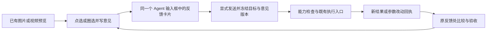

# 图片与视频定点反馈：从 Codex 机制到 Nomi 的最小接入

📋 方案补充，未实施。观察日期：2026-10-12。与[主方案](../../plan/2026-10-12-canvas-agent-collaboration.md)共用版本、评论、执行和审阅原则。

## 1. 判断：值得优先验证，而且比扩 Office 更贴近 Nomi

创作者看到图片上的一个问题，或者视频某一刻的不满意，最费力的是重新在聊天里说明“哪张图、哪个版本、什么位置、哪一秒”。应当让预览直接成为输入入口：**点位置 → 写反馈 → 带着素材进入同一个 Agent 输入框 → 发送 → 回到原位置检查结果。**

用户对趋势的判断成立为一个值得验证的方向：把复杂操作交给 Agent，让人主要表达意图和判断结果。但“最终只是 Prompt 和参数优化”需要加一个条件：这些是执行手段之一，不能代替选区、模型能力和时序约束。调整提示词再生成整张图，可能把已经满意的部分一起改变；局部补绘需要对应能力和 mask；视频还要考虑前后帧连续性。

推荐先验证图片定点反馈与视频单帧/时间段反馈，再扩演示稿和表格。这里改变的是主方案的**验证顺序建议**，不是宣布扩大已批准的实施范围。

## 2. Codex 实际传了什么

### 证据边界

本机安装包路径为 `/Applications/ChatGPT.app`，bundle id 为 `com.openai.codex`，版本 `26.1002.52244`，build `13536`。检查的是 `Contents/Resources/app.asar` 中分发的前端 JavaScript，模块及哈希见[本机机制台账](codex-media-source-ledger.json)。这是静态代码观察，不是 OpenAI 公开 SDK 或服务端源码。

尝试通过 Computer Use 查看应用时，工具以应用安全限制拒绝访问。本次没有绕过限制，没有完成界面点击、真实发送、图片生成或视频修改验证。模块中有 feature flag、聊天/本地 Agent/Library 分支，不能推导每位用户、每个入口都已启用相同体验。以下只复述所检查分支的机制；不把安装包中的代码存在写成当前界面运行成功。

### 2.1 定点评论：图片身份 + 归一化位置 + 原评论

`image-side-panel-8a1bba99f23f.js` 的拾取函数 `hi` 从显示表面的矩形计算 x/y 比例；`app-primary-15d1279f1ff0.js` 的 `pct/mct` 将评论按图片编号组织，加入位置百分比和用户原文，再拼接额外指令。评论与图片附件有关联，不要求用户手写坐标。

同一模块的 Composer 路径 `gct` 保留指定图片附件 id；有 mask 时再加入一个图片附件。提交使用既有 composer submit/附件排队逻辑。因此“看起来直接回到输入框”背后是一组有关联的附件、文字和提交上下文。

**学什么：** 自动带对象和位置，允许继续补充自然语言，再走同一个输入框。Nomi 应在草稿中显示可点回原处的反馈卡片，发送时编译成既有 Agent 接受的上下文，不要求用户阅读或编辑一段坐标文本。

### 2.2 标注：结构化草图 → 覆盖层图片 + 评论文字

`export-1bfb48574ab8.js` 的导出函数 `l` 根据原图尺寸输出 PNG 覆盖层，提取草图中的评论并转成相对位置文字；返回 `overlay` 和 `promptText`。它检查尺寸、像素预算和导出结果，避免无限画布尺寸直接进入提交。

本地路径 `d/createLocalMarkupPreview` 会把原图画为背景，合成可提交的标注图。另一条云端路径 `app-initial-61c077dcc1af.js` 中 `atl` 发送原文件 id 与覆盖层到 markup-preview 服务，再取得图片资产引用和配套文字。没有检查私有服务实现，不能断言两条分支在后端采用相同处理方式。

**学什么：** 可视化标记与文字共同表达意图。Nomi 应保留原图、结构化标注和派生预览三者的关联；不能只保存“画了红圈的 JPEG”，否则难以改评论、撤回标注、再导出 mask 或准确回看。覆盖层用于沟通，单独的 mask 用于支持它的编辑模型，二者不能互相冒充。

### 2.3 擦除：选区不是最终结果

图片侧栏的 `Ei/Si` 分支提交原图与黑白选区图，并加上移除选区的指令；本地 Agent 路径把两者放入附件列表。这里只能证明交给 Agent 的输入形态，不能证明任何下游供应商都会把第二张图作为原生 inpaint mask。

Library 的 `NoteImageEditor` 还有不同分支：把 mask 转成红色高亮，叠到原图，再调用图片生成。它是直接应用到 note 的编辑路径，不能混称为全部都回到聊天输入框。

**学什么：** 工具名可以简单，执行语义要准确。Nomi 现有白板橡皮擦消除的是绘制笔迹；“移除图片中的物体”是另一项操作。不能把白板橡皮擦改名就宣称完成 AI 局部擦除。

### 2.4 去背景与 Resize：快捷操作可以是意图模板

侧栏将去背景转成保留前景并要求透明背景的指令，将 Resize 转成目标宽高比指令，沿同一个图片编辑提交入口执行。Note 分支则先填入可编辑指令，用户再应用。这里的 Resize 可能涉及生成和扩展场景，不能等同确定性的像素缩放；静态调用也不能证明透明通道或最终尺寸必然正确。

**学什么：** 少量快捷动作帮用户表达常见意图，但 Nomi 不必照搬其执行方式。Nomi 已有本地裁剪、旋转、翻转和背景移除，继续走已有操作；只有需要生成的动作进入 Agent/生成链。按钮要区分“缩放像素”与“改比例并扩图”，避免相同词背后发生完全不同的等待、质量和费用。

### 2.5 草稿与发送：异步准备不能吃掉新的意见

Composer 中能看到待上传附件排队、提交目标上下文、取消信号，以及 `imageMarkupSubmission` 的 `draft.isCurrent()` 检查。它们说明标注提交被纳入现有草稿生命周期。我们没有验证所有竞态均被覆盖。

**学什么：** 标注失败保留草稿；图片尚未准备好时不发送空上下文；切项目、换图或编辑评论后，旧准备结果不能发给新的目标。发送成功与修改成功分开，不能点发送就清空唯一的意见记录。

### 2.6 动图：有逐帧反馈代码，不能外推为任意视频编辑

侧栏 `Ji/Yi` 按 `frameIndex` 分组评论，序列化帧编号和各帧中的相对位置；播放速度变化还影响指令中的帧时长。这个分支处理 GIF，足以借鉴“时间身份 + 空间位置”，不足以证明 MP4 的帧精确定位、对象跟踪或整段一致性修改。

## 3. Nomi 已有能力与应补的接缝

Nomi 源码基线为 `0c1ed6a0c9421091f238413d682af97e9aa18d9d`。细化调用链与定位见[媒体源码审计](media-feedback-nomi-audit.md)。

| 能力 | 源码已存在 | 应补什么 |
|---|---|---|
| 图片轻操作 | `useNodeImageEditing` 的裁剪、旋转/翻转、背景移除；产物进入节点结果历史 | 预览入口与同一反馈草稿关联；不能重复造图片历史 |
| 绘制和选区 | 白板已有笔刷、橡皮、几何与 PNG 导出 | 复用合适的小模块；新增评论目标/mask 语义。白板状态不直接变成通用评论账本 |
| Agent 输入 | Composer 附件、assetId/version、主进程图片 bytes 解析与既有 pi 会话 | 从预览把结构化反馈加入当前草稿；MP4 当前没有原生 video part，先明确传截帧和时间文字，不把 file 附件当视频理解 |
| 图片理解与生成 | 现有参考图、能力路由、生成与预算/审批链 | 将评论决定的意图接到能力检查、参数提案和显式执行；按模型区分重生成与局部编辑 |
| 视频取帧/时间轴 | 按秒取帧、clip 与 source 的关联 | 存视频结果版本、媒体时间与展示映射；现有 0.1 秒 UI 取整不能当作帧精确合同 |
| 结果与回看 | 节点结果版本、Run 来源、撤回链 | 评论绑定输入/输出版本，回到原位置验收；生成历史与实际费用仍由原 owner 保存 |

本地背景移除的库及分发许可沿现有依赖单独审视，不能因“已经使用”就推导可随意重新分发。本轮未新增任何依赖。

当前项目素材 version 恒为 1，与内容寻址关联；节点结果的 versionNo 另有历史维护。不能把 attachment.version 当递增媒体修订链，应绑定 resultId 与实际素材内容哈希，外部文件变化还要重验 hash。反馈时冻结 A，发送前改选 B，也应继续指向 A 的原始结果，不重新读取 selectedNodes 猜目标。

## 4. 创作者应该怎样用

图片：在已有节点预览中进入“提修改”，点选位置或圈出区域，写“这里的手指不自然，保留人物和构图”。预览保留编号标记，输入框出现对应图片/结果版本、区域缩略图和这条意见。可以再加第二条、删除一条、补充整图要求，最后一起发送。

视频：播放到一个问题处后进入评论时暂停；显示实际捕获的帧和时间，先支持“这一刻”或明确选择的一段时间。用户圈出人脸并说“这一段表情太夸张”。输入框显示视频、源时间/区间和截图；点击卡片可回到对应时刻。单帧圈选默认只说明这一帧的区域，**不暗示已经跟踪到整段同一人物**。

发送后，Agent 根据真实能力选择处理办法：只改提示词/参数并等待后续生成、直接做已接入的本地轻操作、做支持选区的图像编辑，或者重新生成整个镜头。涉及改变修改范围或新生成，沿现有授权/预算门显示具体方案与成本事实，不另造第二套付费弹窗。不支持视频局部修改时，明确显示“可调整下一轮生成 / 可重生成镜头”等实际选项，让用户选择，不能把整段重生伪装成精准局部修复。

结果在原节点历史出现，反馈旁显示输入和输出版本、实际改动与待验收状态。用户可切前后图、在相同时间查看前后视频、继续提意见或撤回。只改了 Prompt 时显示“参数已修改，尚未生成新结果”；生成失败时保留原结果和意见，不宣称视觉问题已修好。

## 5. 只自研反馈与领域对象的对应关系

以下是拟议合同，不是现有 API 或已经安装的能力。字段应在既有 TargetRef/附件/命令边界扩展，准确命名与存储 owner 在探针中通过 door-map 定案。

| 内容 | 最小必要信息 | 目的 |
|---|---|---|
| 目标 | projectId、nodeId、resultId、源 assetId/version/contentHash（按现有 owner 可提供的事实补齐） | 同节点换结果后，旧意见仍指向旧图；缺版本信息就不能声称可安全写回 |
| 空间 | 原图/显示变换后的统一坐标系、point/rect、必要时 polygon/brush；原媒体尺寸和方向 | 去掉缩放、留白、旋转的影响；不存屏幕像素当永久位置 |
| 时间 | source media 的时间戳；需要帧精确时保存实际解码帧 PTS/timebase 和帧截图哈希；区间有起止 | 可变帧率不能用 seconds × fps 猜帧。没有精确 PTS 就标按秒定位 |
| 时间轴关联 | 可选 clipId、时间轴位置及当时的源片段/变速/裁切映射版本 | clip 调整后不把旧时间静默指向新内容；反向/变速/转场使用既有映射能力，不能自写简单换算假装覆盖 |
| 意见 | feedbackId、意见 revision/fingerprint、原文、保存时间、显式选中的提交范围 | 上传期间改了意见，旧任务不能把新意见标成已完成 |
| 素材 | 原图/原视频引用、无标注帧截图、可选标注预览、可选编辑 mask，各自的用途和来源 | Agent 理解素材与模型编辑输入分离；发送必要上下文，不默认上传整个项目 |
| 操作 | 用户期望、允许的范围、实际能力选项、必要 preconditions | 不能只靠 Prompt 要求不越界；提交执行时由既有能力门校验 |
| 回执 | command/run、输入版本、输出 result、参数 diff、实际调用/费用、逐意见状态 | “已发送”“参数已改”“生成已完成”“用户满意”分别可核查 |

持久记录的唯一 owner 是项目内的反馈记录；Composer 只引用反馈草稿，发送时冻结一个批次。原始媒体字节仍属于资产 owner，图片结果仍属于节点结果历史，视频生产仍归 Run，pi 仍负责会话和工具循环。不在输入框再保存一套永久评论，不建第二套 Agent runtime。

给 Agent 的上下文包含可读文字和既有多模态附件；结构化记录保留在宿主，负责校验、回看与幂等。模型支持结构化字段时可传结构化上下文，不能假设所有模型理解自定义协议。圈选只是人指的范围，是否实际保持区域外内容必须看结果，不因存在 mask 就宣称有强保证。

跨版本的图片评论默认回看原结果，不按相同比例强行贴到重生成的新图。新图中人物或构图可能变化；未来自动重定位只能先给候选、显示置信与变化，再确认新目标。视频也一样，剪掉一个片段后，旧评论不能自动顺延到另一个镜头。

## 6. 复用组件的具体取舍

1. 保留 React Flow 的节点、现有预览、图片编辑与历史版本；标注只在当前打开的媒体上挂一层，避免重做画布或把整套白板塞进节点。
2. 点评论先复用已有 React/预览坐标与事件边界；笔刷优先验证现有 Leafer/白板的小模块能否脱离白板 owner 使用。需要多区域几何批注时，再评估此前核查的 Annotorious 3 BSD-3-Clause 组件，由适配器把输出交给同一反馈 owner。不要同时持久化 Annotorious 和白板两套意见。
3. Mask 导出复用成熟图形/Canvas 能力，由具体模型适配器转换所需尺寸、颜色和透明约定；不能拿白板橡皮的笔迹 JSON 直接当模型 mask。
4. 视频读取、取帧、缩略图、时间映射继续用现有链路；只有真实需求要求时，才新增帧 PTS 精确捕获。首轮不引入对象跟踪、视频分割或通用视频编辑器。
5. Codex 是机制参考；本轮只记录观察，不复制其私有分发代码、不调用其内部服务、不把它当开源依赖。可以借鉴接口分层、归一化坐标、异步草稿校验和快捷意图模板。

Annotorious 与许可详见[批注组件研究](annotation-components.md)；媒体现有模块的许可和调用边界见[源码审计](media-feedback-nomi-audit.md)。

## 7. 建议的最小验证顺序与指标

**第一轮先做图片。** 一张已有真实图片上积累 2–3 条点评论，回填同一个 Composer，提交一次，走一个已经验证支持参考图的模型/执行路线，再将新版本和逐条反馈对应起来。先证实反馈提交和结果回看；矩形选区、mask 和局部编辑必须分别验证，不能拿整图生成成功抵扣。

**第二轮做视频反馈。** 真实视频暂停、捕获帧、加点评论/时间段、回填/发送、Agent 读取所需帧及时间上下文并正确理解目标。当前不以 MP4 file 附件替代视频理解；若未来接原生视频输入，要另验能力。视频局部修复尚不作为首轮承诺；可验证调整下一轮镜头生成或支持的时间轴轻操作，回执明确本次真正执行了什么。

**第三轮再扩快捷动作和混合成果。** 保留已有确定性操作，逐一验证生成式擦除/扩图的能力和费用；与文稿/HTML 评论共用反馈记录和审阅。Office 扩展放在媒体闭环证实收益之后。

| 验收点 | 用真实素材留下什么证据 | 阻断条件 |
|---|---|---|
| 位置理解 | 相同素材的聊天描述基线与定点反馈对照；每轮记录用户纠正位置次数 | 目标对象反复认错却只报工具成功 |
| 图像坐标 | 缩放、object-contain 留白、横竖图、旋转/方向、不同设备像素比下前后截图与坐标 | 点位随缩放漂移；把预览框留白当图像区域 |
| 视频时间 | 实际截帧与标注时间；可变帧率、clip 裁切/变速/反向的支持表 | 按秒捕获却标帧精确；剪辑后旧评论无提示地指向新帧 |
| 草稿与恢复 | 多意见、删除/改意见、切图/切项目、上传失败/取消/重启和重复发送 | 草稿丢失、发错项目、旧提交关掉新意见、重复付费调用 |
| 能力与范围 | 输入/输出/参数 diff；局部编辑的区域内质量和区域外变化；视频前后片段对照 | 不支持局部修改却宣称已精准修复；参数改了就宣称图改好了 |
| 体验与成本 | 人操作时长、模型等待、输入/上传字节、实际费用、首轮采纳率、纠正回合 | 没有基线；成本未知却写成免费或已确认金额 |

建议从 6 个图片任务和 6 个视频反馈任务开始，每个连续 3 轮，交叉安排聊天与定点反馈；沿主方案的试点目标记录位置重述是否下降至少 30%，不把样本量当作统计显著性保证。图片执行与视频反馈分别报告，不合成一个漂亮的“成功率”。

新增标注/取帧/发送操作须依仓库规则登记 `tests/perf/scenarios/` 并跑真实基线。探针建议覆盖 4K 图片、项目中 20 个媒体节点、每个目标 20 条意见，只有当前预览活动；分别记录指选反馈 p95、标注导出耗时/峰值内存、取帧与提交时延。建议指选反馈 p95 <100ms，其余预算由第一次基线确定，当前全部未测量。不能一次挂 20 个活动视频或将全分辨率 base64 塞进全局 store。

## 8. 本次交付与剩余证据

本次新增机制观察、Nomi 接线审计、拟议反馈合同、推荐顺序和验收矩阵；没有改产品代码或调用模型。Codex UI 复现受工具限制，私有后端未知，Nomi 真实媒体→Agent→结果闭环仍待探针。后续实施前用生产组件给出交互候选、补完整设计卡与性能基线，再进入产品实现。

[独立读者审读](media-feedback-reader-review.md)保留首次分期矛盾和修订复查；当前无未关闭的决策级文档问题。此结论只用于评审方案，不替代运行验证。
